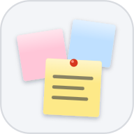

<p align="center">
  
</p>

<h1 align="center">Stick Note</h1>

<p align="center">
  <b>One whiteboard. Stick a note anywhere, find it by remembering where you put it.</b>
</p>

<p align="center">
  <a href="https://github.com/vytk712025main-eng/stick-note/releases/latest"></a>
  <a href="https://github.com/vytk712025main-eng/stick-note/actions/workflows/ci.yml"></a>
  <a href="LICENSE"></a>
</p>


Stick Note is a private notes app with **one screen**: a big, endless whiteboard. Drag a paper slip onto it, type a thought or paste a link, and leave it there. No folders, no tags, no lists. **Where you put a note is how you find it again.**

- **Quick.** Drag a slip, double-click anywhere, or press `Ctrl+V` to turn text, links and screenshots into notes.
- **Zones.** When the board gets busy, draw a labelled area around some notes: *Important*, *Normal*, *Low priority* (its notes fade into the background) or *Private* (its notes are blurred until you click them). Nothing is ever moved or sorted for you.
- **Yours alone.** Everything stays on your computer. No account, no cloud, no tracking. Works offline.
- **Safe.** Saves as you type, makes a backup every day, and keeps deleted notes in a trash for 60 days.
- **Light.** Opens instantly and stays smooth (tested with 1,500+ notes). Available in English and Tiếng Việt.

## Install

Download **one file** from the [latest release](https://github.com/vytk712025main-eng/stick-note/releases/latest) and double-click it. You do **not** need Node.js, a terminal or an account.

| Your computer | Download | Then |
|---|---|---|
| **Windows 10 / 11** | `StickNote-<version>-windows-x64-setup.exe` | Double-click, click **Install**, click **Finish**. |
| **Ubuntu, Debian, Linux Mint** | `stick-note_<version>_amd64.deb` | Double-click, click **Install**. |
| **Any other Linux** | `StickNote-<version>-linux-x64.AppImage` | Right-click, **Properties**, allow running it as a program, then double-click. |

Then open **Stick Note** from your Start menu, desktop or applications menu.

<details>
<summary><b>Windows says "Windows protected your PC"</b></summary>

That message appears for every new app that is not code-signed yet (certificates cost money). Click **More info**, then **Run anyway**. If you want to check the download first, compare its SHA-256 with `SHA256SUMS.txt` on the release page, or run `gh attestation verify <file> --repo vytk712025main-eng/stick-note` to prove it was built by this repository. For versions up to 1.2.0 (built before the project moved here) use `--owner tranquocvy3107` instead of `--repo vytk712025main-eng/stick-note`.
</details>

<details>
<summary><b>I don't want to install anything (portable)</b></summary>

Download `StickNote-<version>-windows-x64-portable.zip` (Windows) or `StickNote-<version>-linux-x64.tar.gz` (Linux), unpack it anywhere (a USB stick works), and run **Stick Note.exe** or `stick-note`. Your notes are saved in a `data` folder next to it, so copy the whole folder to move to another computer.
</details>

<details>
<summary><b>Linux tips</b></summary>

- Stick Note opens in its own window when **Chrome, Chromium, Edge or Brave** is installed. Otherwise it opens in a tab of your default browser, which works too.
- If the AppImage refuses to start and mentions **FUSE**, install your distribution's `fuse3` package (a few older systems need `libfuse2` instead). The `.deb` has no such requirement.
- Remove it with `sudo apt remove stick-note`. Your notes stay in `~/.local/share/stick-note`.
</details>

**Updating:** run the new installer over the old one. Your notes are kept. **Uninstalling** never deletes your notes either.

<details>
<summary><b>I used version 1.0 (unzipped folder with <code>start.bat</code>)</b></summary>

If you keep running it from that folder, nothing changes: your notes stay in its `data` folder. To switch to the installer, quit Stick Note, install the new version, quit it again, and copy everything inside your old `data` folder into the new data folder: press `Win + R`, type `%APPDATA%\Stick Note` and press Enter on Windows (`~/.local/share/stick-note` on Linux). Then start Stick Note again.
</details>

## Use it in 30 seconds

| I want to... | Do this |
|---|---|
| Add a note | Drag a slip from the tray (bottom-left) onto the board and type. Or double-click the board, or press `N`. |
| Paste fast | `Ctrl+V` turns text, a link or a screenshot into a note. |
| Bring things in | Drop links, images, `.url` or `.txt` files onto the board. |
| Edit | Double-click the note (or press `Enter`). `Esc` or a click outside finishes. |
| Reuse | Click a link to open it; the small button beside it copies it. `Ctrl+C` copies a whole note. Double-click an image to see it large. |
| Move around | Drag the background, scroll, use the arrow keys, or hold `Space` and drag. |
| Zoom | `Ctrl` + scroll, or the `+` / `-` buttons. |
| Come back | `Home` returns to the start. `Shift+1` shows every note. |
| Search | `Ctrl+F` or `/`. Matching notes light up and nothing moves. Accents are ignored. |
| Keep a note in place | Click its pin icon to lock its position. |
| Draw a zone | Press and hold on an empty spot for half a second, then drag. (A quick drag still moves the board.) Or press `Z`, drag the dashed tile from the tray, or select some notes and press `G` to put a zone around them. |
| Change a zone | Click its name tab: pick *Important*, *Normal* or *Low priority*, make it *Private*, or delete it. Drag the tab to move the zone together with the notes inside it (pinned notes stay), drag an edge or corner to resize, double-click the tab to rename. |
| Delete | Press `Delete` or drag it onto the trash can. The trash keeps notes for 60 days. |
| Undo | `Ctrl+Z` and `Ctrl+Y`. |
| Select several | `Shift` + drag on the background, `Shift` + click, or `Ctrl+A`. |
| Switch language or theme | Menu (the three dots), then **Language** or **Appearance**. |

Press `?` inside the app for the full list. Quit with Menu, **Quit Stick Note** (closing the window also lets it stop by itself after a few minutes).

## Your notes and your privacy

- Notes live in a **data folder** on your computer: `%APPDATA%\Stick Note` on Windows, `~/.local/share/stick-note` on Linux, or the `data` folder next to the app for portable copies. Open it from the menu: **Open data folder**.
- The folder holds `board.json` (your notes), `images/`, `backups/` (one backup per day, plus an extra one if many notes disappear suddenly) and `server.log`. Copy the folder to back up or move.
- Stick Note talks only to your own computer (`127.0.0.1`). It sends nothing anywhere.
- **Notes are stored as ordinary files and are not encrypted yet.** Encryption is on the [roadmap](#roadmap). Until then, do not keep secrets in it unless your disk is encrypted (BitLocker on Windows, LUKS on Linux).
- A *Private* zone only **hides its notes from someone glancing at your screen**. It does not encrypt anything: search still finds those notes and copying still copies their text.

## Something wrong?

| Problem | What to do |
|---|---|
| "Can't reach the server" | Close the window and open Stick Note again from its shortcut. The page reconnects by itself. |
| It opens in a browser tab, not its own window | Install Edge, Chrome, Chromium or Brave. Firefox cannot open app windows. |
| "Port 4747 is in use" | Another program uses it. Set the environment variable `PORT` to another number, then start Stick Note again. |
| I deleted too much | Press `Ctrl+Z` right away. Otherwise open the trash, or copy a file from `backups/` over `board.json` (quit Stick Note first). |
| I want to see what the server is doing | Read `server.log` in the data folder. |

Still stuck? [Open an issue](https://github.com/vytk712025main-eng/stick-note/issues/new/choose); it helps a lot if you say which system and which Stick Note version you use (shown in the file name you downloaded).

## For developers

Stick Note is a zero-dependency Node.js server (`server.js`, `src/`) plus a vanilla JavaScript interface (`public/`), with no build step.

```bash
git clone https://github.com/vytk712025main-eng/stick-note.git
cd stick-note
npm test                # needs Node.js 20.11 or newer
node server.js --open   # start it and open the app window (also: ./start.sh, start.bat)
```

- [CONTRIBUTING.md](CONTRIBUTING.md): ground rules, project layout, tests, translations.
- [tools/package/README.md](tools/package/README.md): how the installers are built.
- [CLAUDE.md](CLAUDE.md): architecture notes and decisions (written for AI coding agents, useful for people too).
- [SECURITY.md](SECURITY.md): how to report a vulnerability.

## Roadmap

- **A vault for sensitive notes:** encryption with a passphrase, private zones that also stay out of search and the clipboard, version history, and backup and restore tools.
- **macOS** builds.

## License

[MIT](LICENSE)
