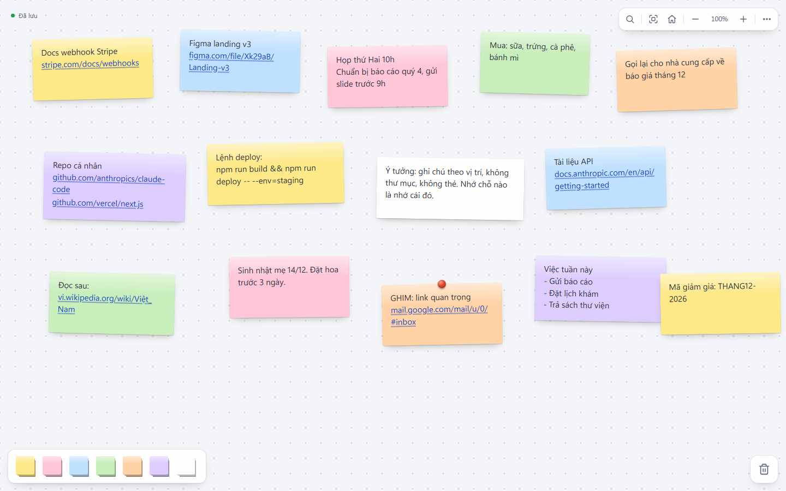
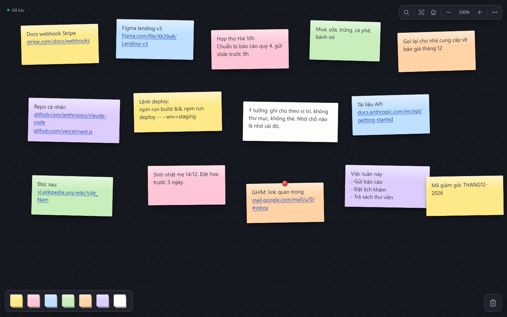

# Stick Note

[](https://github.com/tranquocvy3107/stick-note/actions/workflows/ci.yml)
[](https://github.com/tranquocvy3107/stick-note/releases/latest)
[](LICENSE)

Whiteboard giấy nhớ của riêng bạn. Chỉ có một tấm bảng: kéo mảnh giấy vào, ghi chữ, link hoặc dán ảnh, rồi để nguyên đó. Không thư mục, không thẻ, không danh sách. Vị trí trên bảng chính là cách bạn nhớ.



<details>
<summary>Giao diện tối</summary>



</details>

## Cài đặt

Cần Windows 10/11, **Node.js 20.11 trở lên** và Edge hoặc Chrome. Không cần `npm install`.

1. Vào [Releases](https://github.com/tranquocvy3107/stick-note/releases/latest), tải file `stick-note-<phiên bản>.zip`.
2. Giải nén ra một thư mục cố định, ví dụ `D:\Apps\stick-note`.
3. Làm theo phần "Mở app" bên dưới.

Nâng cấp: giải nén bản mới ra thư mục mới rồi chép thư mục `data/` của bản cũ sang. Hoặc đặt biến môi trường `STICK_NOTE_DATA` trỏ tới một thư mục dữ liệu cố định để không phải chép.

## Mở app

Bấm đúp **`start.bat`**. App mở thành một cửa sổ riêng (không thanh địa chỉ, không tab) và chạy hoàn toàn trên máy bạn, không cần mạng. Đóng cửa sổ là xong; máy chủ nhỏ chạy ngầm sẽ tự tắt sau khoảng 5 phút.

Mở từ terminal thì gõ `.\start.bat` hoặc `npm start`. Máy này đặt biến `NoDefaultCurrentDirectoryInExePath=1` nên gõ trần `start.bat` sẽ báo "not recognized" (bấm đúp và shortcut không bị ảnh hưởng).

Muốn có biểu tượng ngoài màn hình nền, chạy một lần:

```powershell
powershell -ExecutionPolicy Bypass -File tools\create-shortcut.ps1
```

Thêm `-StartMenu` nếu muốn cả trong menu Start. Máy cần có Node.js (đã cài sẵn thì không phải làm gì thêm).

## Cách dùng

| Việc cần làm | Cách làm |
|---|---|
| Thêm giấy | Kéo một tờ ở khay góc dưới trái vào bảng rồi gõ. Hoặc nhấp đúp lên nền, hoặc phím `N` |
| Dán nhanh | `Ctrl+V` dán chữ, link hoặc ảnh chụp màn hình thành một mảnh giấy mới |
| Kéo từ ngoài vào | Thả link, ảnh, file `.url` hoặc `.txt` thẳng lên bảng |
| Sửa | Nhấp đúp (hoặc `Enter`). `Esc` hoặc nhấp ra ngoài là xong |
| Dùng lại | Bấm link để mở. Nút nhỏ cạnh link để copy link. `Ctrl+C` copy cả mảnh giấy. Nhấp đúp vào ảnh để xem lớn |
| Di chuyển bảng | Kéo nền, cuộn chuột, phím mũi tên, hoặc giữ `Space` rồi kéo |
| Zoom | `Ctrl` + cuộn chuột, hoặc nút `+` `-` ở góc trên phải |
| Về chỗ cũ | `Home` về vị trí gốc 100%. `Shift+1` xem tất cả mảnh giấy |
| Tìm | `Ctrl+F` hoặc `/`. Mảnh khớp sáng lên, vị trí không đổi. Gõ không dấu cũng tìm ra tiếng Việt |
| Ghim | Biểu tượng ghim trên mảnh giấy khóa vị trí để không kéo nhầm |
| Xóa | `Delete` hoặc kéo vào thùng rác. Giấy được giữ 60 ngày, khôi phục trong ngăn thùng rác |
| Hoàn tác | `Ctrl+Z` / `Ctrl+Y` |
| Chọn nhiều | `Shift` + kéo trên nền, hoặc `Shift` + bấm, hoặc `Ctrl+A` |

Bấm `?` trong app để xem bảng phím tắt đầy đủ.

## Dữ liệu của bạn nằm ở đâu

Trong thư mục **`data/`** cạnh app:

- `board.json`: toàn bộ mảnh giấy và thùng rác
- `images/`: ảnh bạn dán (giữ nguyên bản gốc, kèm bản thu nhỏ để bảng nhẹ)
- `backups/`: mỗi ngày một bản sao lưu, thêm một bản khi số mảnh giấy đột ngột giảm mạnh, và các bản bạn tự bấm "Sao lưu ngay" trong menu
- `server.log`: nhật ký của máy chủ, chỉ xem khi có sự cố

Chép cả thư mục `data/` là đủ để chuyển sang máy khác. Muốn đặt dữ liệu ở chỗ khác (ví dụ trong OneDrive để tự đồng bộ), đặt biến môi trường `STICK_NOTE_DATA` trỏ tới thư mục đó trước khi chạy `start.bat`. Menu `⋯` có mục **Mở thư mục dữ liệu**.

App lưu tự động sau mỗi thay đổi. Nếu máy chủ tắt giữa chừng, app báo bằng dải đỏ, giữ tạm ghi chú trong cửa sổ và tự lưu lại khi kết nối trở lại. Mở hai cửa sổ cùng lúc cũng không mất gì: thay đổi của hai bên được gộp lại.

## Khi có sự cố

- **Cửa sổ báo "Chưa kết nối được máy chủ"**: bấm lại `start.bat`. Cửa sổ cũ sẽ tự nối lại.
- **Muốn xem lỗi**: chạy `start-debug.bat` (hiện log ngay trên màn hình), hoặc mở `data/server.log`.
- **Cổng 4747 bị chương trình khác dùng**: đặt biến môi trường `PORT` sang số khác rồi chạy lại.
- **Lỡ xóa nhiều mảnh giấy**: thử `Ctrl+Z` ngay; nếu đã đóng app thì lấy từ ngăn thùng rác, hoặc chép lại `backups/board-<ngày>.json` thành `board.json` (tắt app trước khi chép).

## Dành cho người sửa code

Xem `CLAUDE.md`. Kiểm thử tự động: `npm test`. Lịch sử phiên bản nằm trong `CHANGELOG.md`.

## Giấy phép

[MIT](LICENSE)
